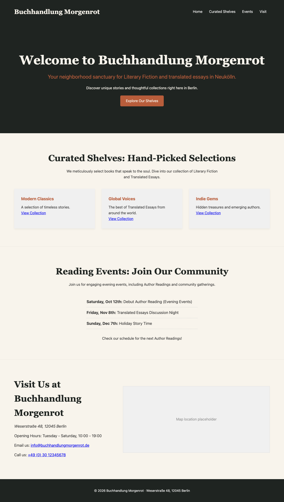
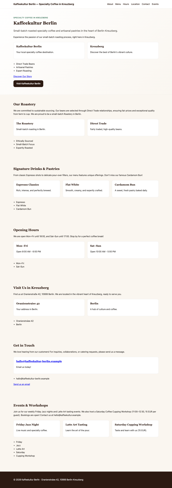
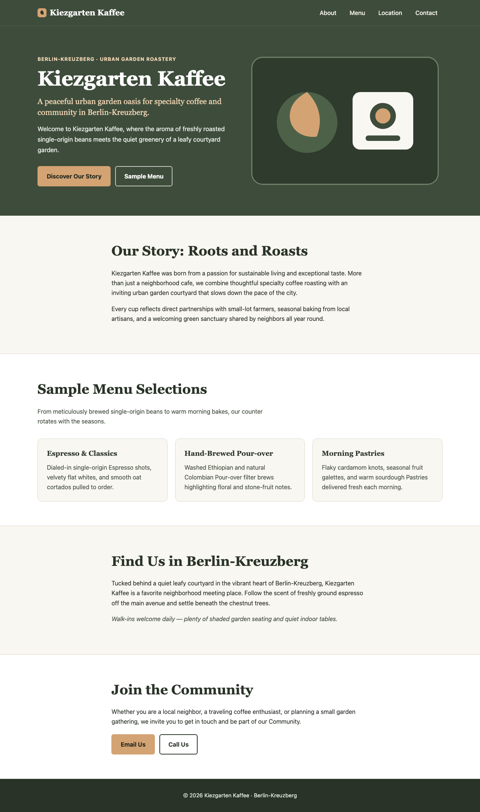
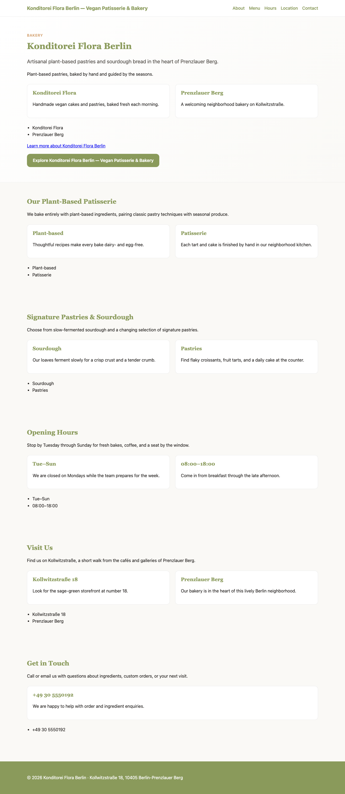

# ai-factory-websites

[](https://github.com/barbarosydev/ai-factory-websites/actions/workflows/ci.yml)
[](LICENSE)
[](tests/site.spec.mjs)
[](docs/adr/0003-wcag-accessibility-gates-with-axe-core.md)

Static single-page websites generated, verified, and maintained autonomously by [`ai-factory`](https://github.com/barbarosydev/ai-factory) on local Apple Silicon models.

## How a User Interacts With the Factory

1. **Submit a Request**: Open either GitHub Issue Form in [`.github/ISSUE_TEMPLATE/`](.github/ISSUE_TEMPLATE/config.yml):
   - **[Create a New Website](.github/ISSUE_TEMPLATE/01-new-website.yml)**
   - **[Modify an Existing Website](.github/ISSUE_TEMPLATE/02-modify-website.yml)**
   - Issues created from either form automatically carry `factory:ready` (only explicitly eligible issues enter the single-issue FIFO queue).
2. **Track Progress via Labels**:

| Label | Meaning |
| --- | --- |
| `factory:ready` | Queued for the factory's FIFO poller |
| `factory:running` | Actively executing in an isolated `.worktrees/issue-<N>/` worktree |
| `factory:waiting` | Paused in Temporal waiting for a human clarification comment |
| `factory:review` | Built and Playwright-verified; PR awaiting human merge (`review` mode) |
| `factory:done` | Remote GitHub Actions passed and PR autonomously squash-merged (`auto` mode) |
| `factory:rejected` | Cleanly rejected as outside v1 static single-page scope |
| `factory:failed` | Exhausted 3 bounded repair attempts; failure snapshot archived locally |

3. **Review or Answer**: Reply to any `factory:waiting` comment to resume the workflow within ~15s, or inspect inline desktop (`1280x800`) and mobile (`375x812`) screenshots attached to every opened PR. See the full [User & Operator Journey](https://github.com/barbarosydev/ai-factory/blob/main/docs/user-journey.md) in `ai-factory`.

## 9 Deterministic Quality Gates

Every generated or modified site under `sites/<slug>/` must pass all 9 automated Playwright gates ([`site.spec.mjs`](tests/site.spec.mjs)) before a PR is opened or merged:

- **Static & Zero-External-Network**: Plain HTML5/CSS/vanilla JS with zero per-site `package.json` or external CDN/network requests.
- **Responsive Layout & Overflow**: Zero horizontal or child-element overflow across desktop (`1280x800`) and mobile (`375x812`).
- **Accessibility (WCAG 2.1 AA)**: Zero serious/critical `@axe-core/playwright` violations, including color-contrast checks.
- **Anti-Prompt-Leak & `spec.json` Contract**: Navigation, footer, and content match `spec.json`, with `STRICT_COPY=1` catching placeholder stubs and leaked instructions.
- **Visual Evidence**: Fresh `evidence/desktop.png` and `evidence/mobile.png` screenshots generated per run.

## Sites Catalog

| Slug | Category | Status | Source |
| --- | --- | --- | --- |
| [`_template`](sites/_template/index.html) | Reference template | Active | Baseline for Playwright navigation, footer, layout, WCAG AA, and strict-copy gates |
| [`buchhandlung-morgenrot`](sites/buchhandlung-morgenrot/index.html) | Local Store | Active | Built via Issue #15 -> PR #16; updated via [Issue #26](https://github.com/barbarosydev/ai-factory-websites/issues/26) -> PR #27 |
| [`kaffeekultur-berlin`](sites/kaffeekultur-berlin/index.html) | Coffee Shop | Active | Built via [Issue #5](https://github.com/barbarosydev/ai-factory-websites/issues/5) -> PR #6; updated via PR #10 & PR #28 |
| [`kiezgarten-kaffee`](sites/kiezgarten-kaffee/index.html) | Coffee Shop | Active | Built via [Issue #22](https://github.com/barbarosydev/ai-factory-websites/issues/22) -> PR #23; WCAG refresh in PR #28 |
| [`konditorei-flora-berlin`](sites/konditorei-flora-berlin/index.html) | Bakery / Patisserie | Active | Resumed from `factory:waiting` via [Issue #7](https://github.com/barbarosydev/ai-factory-websites/issues/7) -> PR #8; refreshed in PR #28 |

### Showcase Previews (`1280x800` Verified Evidence)

| Buchhandlung Morgenrot | Kaffeekultur Berlin |
| --- | --- |
|  |  |
| **Kiezgarten Kaffee** | **Konditorei Flora Berlin** |
|  |  |

## Local Verification & Preview

See [docs/prerequisites.md](docs/prerequisites.md), [docs/runbook.md](docs/runbook.md), and [docs/harness.md](docs/harness.md). From a fresh clone:

```bash
brew bundle --no-upgrade
mise install
npm ci
npx playwright install chromium
pre-commit install
```

```bash
# Verify a single site across all 9 Playwright + axe-core WCAG gates
SITE_SLUG=kaffeekultur-berlin task test

# Preview a site locally in your browser
SITE_SLUG=kaffeekultur-berlin task preview

# Run all linters, policies, hook tests, Playwright suite across all sites, and secret scan
ALL_SITES=1 task ci
```

## Architecture Decisions

- [0001. Vanilla static stack and shared Playwright harness](docs/adr/0001-vanilla-static-stack-and-shared-playwright-harness.md)
- [0002. Public repository governance, `/sites/` loopback isolation, and read-only Playwright verification](docs/adr/0002-public-repo-governance-and-readonly-verification.md)
- [0003. WCAG accessibility gates with `@axe-core/playwright`](docs/adr/0003-wcag-accessibility-gates-with-axe-core.md)
