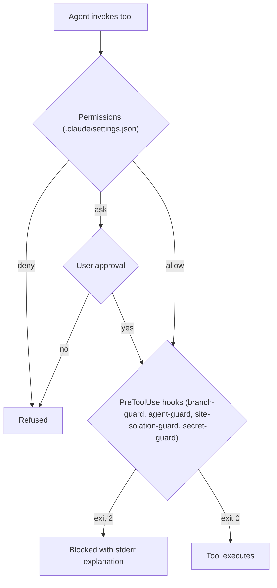

# AI Agent Harness

`ai-factory-websites` includes a Day-0 AI Agent Harness matching the platform conventions across `ai-factory-infra` and `ai-factory`.

| Piece | File | Purpose |
| --- | --- | --- |
| Rules | [AGENTS.md](../AGENTS.md), [CLAUDE.md](../CLAUDE.md), `.claude/rules/` | Architecture, task commands, hard rules, and path-scoped rules (`sites.md`, `playwright.md`, `scripts.md`) |
| Permissions | [.claude/settings.json](../.claude/settings.json) | Allow, ask, and deny lists for tool calls |
| Hooks | `.claude/hooks/` | `site-isolation-guard.sh`, `branch-guard.sh`, `agent-guard.sh`, `secret-guard.sh`, `session-context.sh` |
| Skills | `.claude/skills/` | `preview-site`, `upgrade-version`, `ship-pr` |
| Review agent | [.claude/agents/site-verifier.md](../.claude/agents/site-verifier.md) | Read-only pre-PR verification agent |
| Policies | [policy/README.md](../policy/README.md) | Conftest Rego policies enforcing SHA-pinned workflows and Claude Code guard hooks |

## Tool Call Gates

## Hook Test Suite

`tests/hooks/run.sh` runs during `task test` and `task ci` to verify that every guard hook blocks forbidden actions (commits on `main`, per-site `package.json` writes, mutating commands inside `site-verifier`, and leaked secrets) while allowing normal site development and verification.
